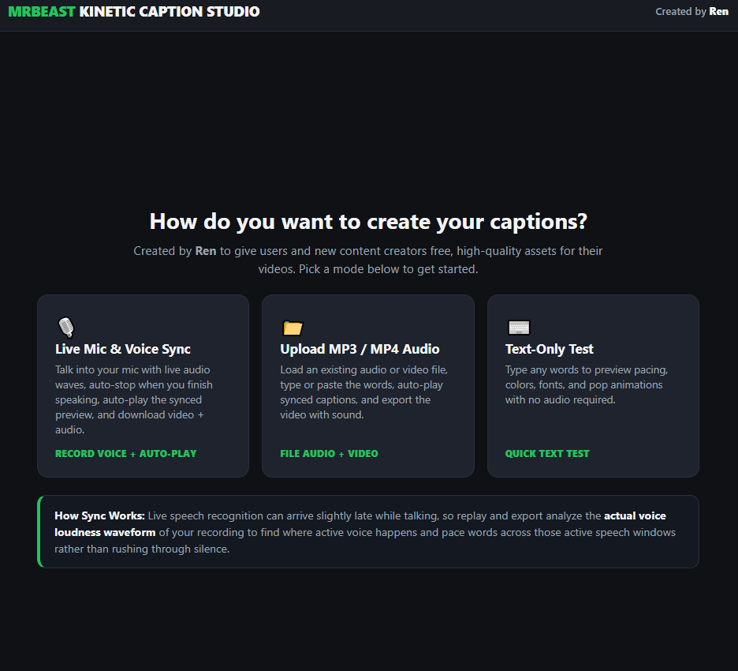

# MRBEAST KINETIC CAPTION STUDIO

Created by **Ren** to give users and new content creators free, high-quality assets for their videos.

## Overview

**Kinetic Caption Studio** is a single-file browser tool for generating bold, high-contrast kinetic captions with pop animations, active-word color highlights, and video + audio export.

## Modes & Features

- **Live Mic & Voice Sync:** Speak into your microphone with a real-time voice waveform visualizer, voice-gated intro captions (captions wait until voice energy starts), adjustable auto-stop after silence, automatic synced preview playback, and video + audio export.
- **Upload MP3 / MP4 Audio:** Load an existing audio or video file, enter or paste your script, sync captions across active voiced waveform windows, preview playback, and export.
- **Text-Only Test:** Type any script to test words-per-second pacing, fonts (`Montserrat`, `Bangers`, `Rubik`, `Impact`), active word color, background color, font size, outline thickness, and aspect ratio (`16:9` horizontal or `9:16` vertical).
- **Video + Audio Export:** Renders frames at 60 FPS on HTML5 `<canvas>` and records video with audio using `MediaRecorder` (`MP4` when supported by the browser, with `WebM` fallback).

## How to Use

1. Open the HTML studio file in a modern browser (Chrome or Edge recommended for live speech recognition).
2. Choose one of the three modes on the start menu: **Live Mic & Voice Sync**, **Upload MP3 / MP4 Audio**, or **Text-Only Test**.
3. Customize your words, group size (`1`, `2`, or `3` words), font, colors, sizing, and aspect ratio (`1920x1080` or `1080x1920`).
4. Preview your captions and click **Download Video + Audio** to save your clip.

## Author

Created by **Ren** ([@Ren23447](https://github.com/Ren23447)).
